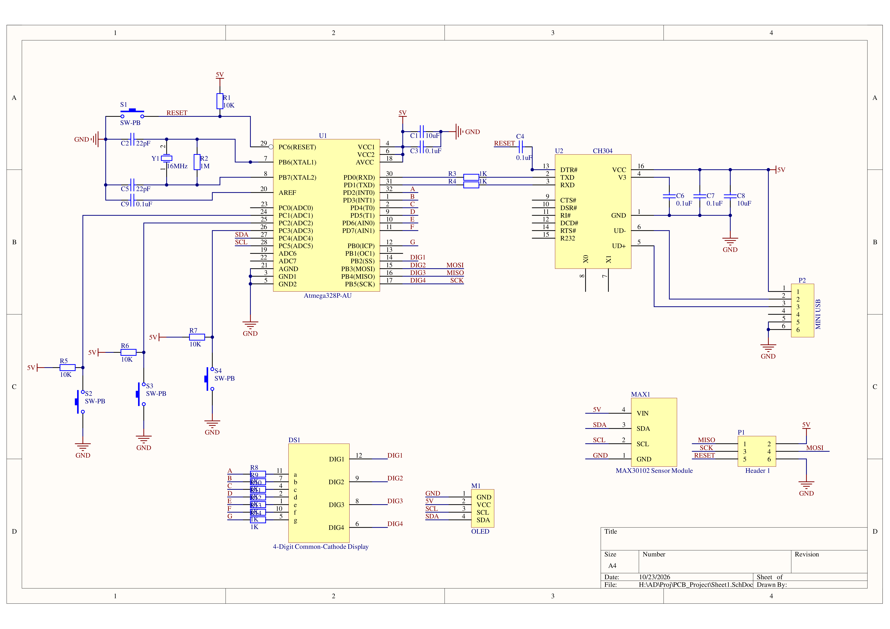
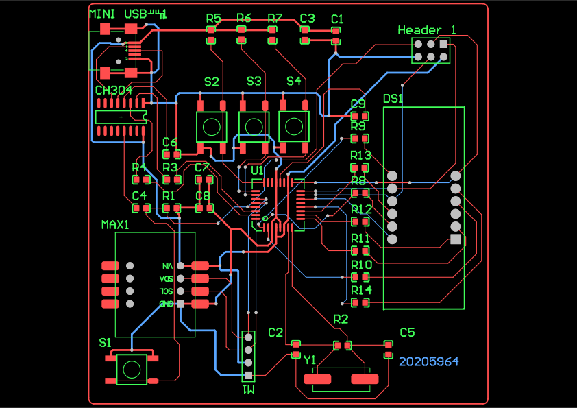
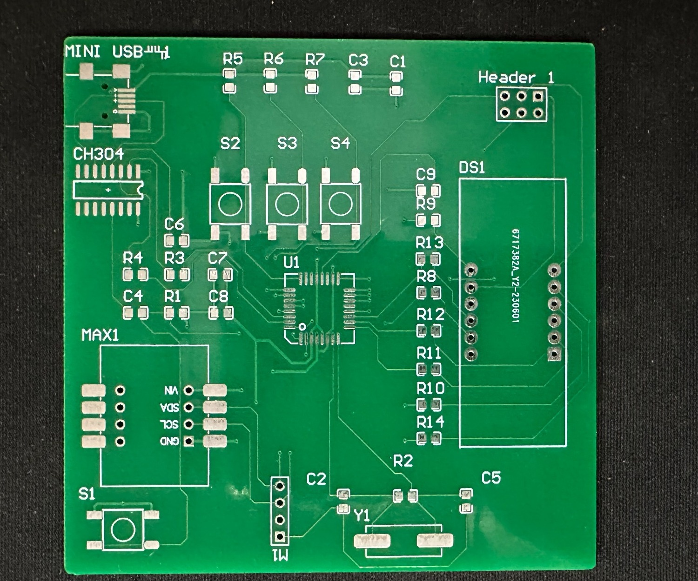
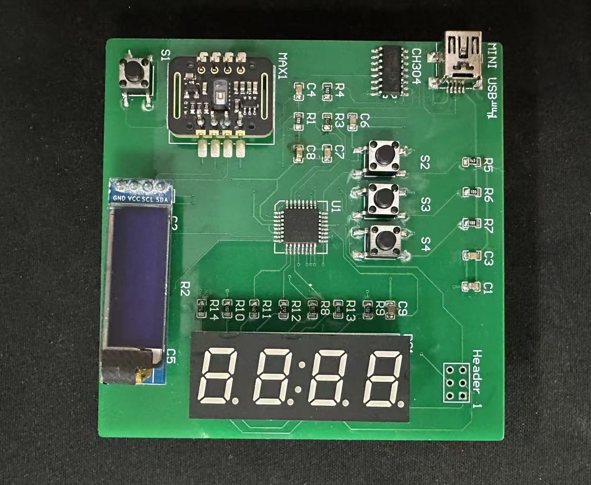
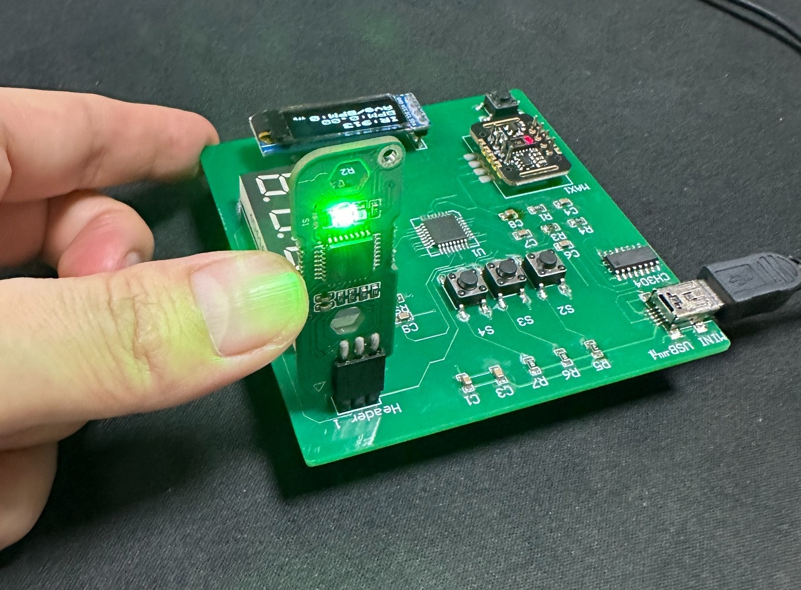

# Custom ATmega328P Optical Sensing Board

## 1. Hardware Design

### Schematic Design

### PCB Layout and Routing

## 2. PCB Fabrication and Assembly

| Fabricated PCB | Assembled PCB |
|:---:|:---:|
|  |  |

## 3. Bootloader Programming and Bring-up

  

## 4. Firmware Demonstration

### Demonstration Video

<!-- Insert the finished demonstration video here. -->

### Application Modes

| RAW Mode | STATS — Measuring | STATS — Idle |
|:---:|:---:|:---:|
|  |  |  |

## 5. Firmware Architecture

## 6. Repository Structure

## 7. Notes and Limitations
