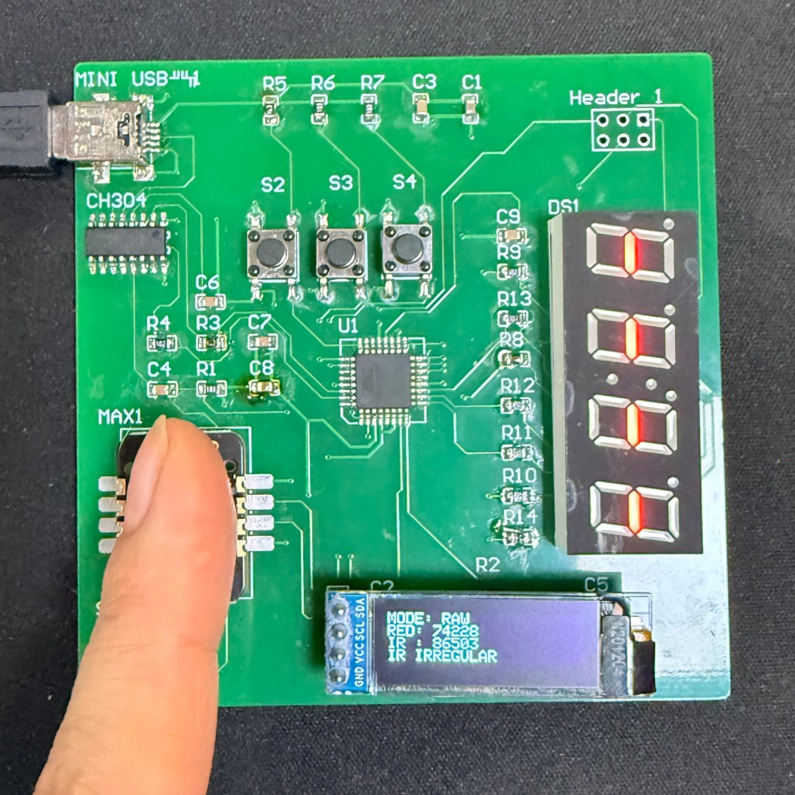
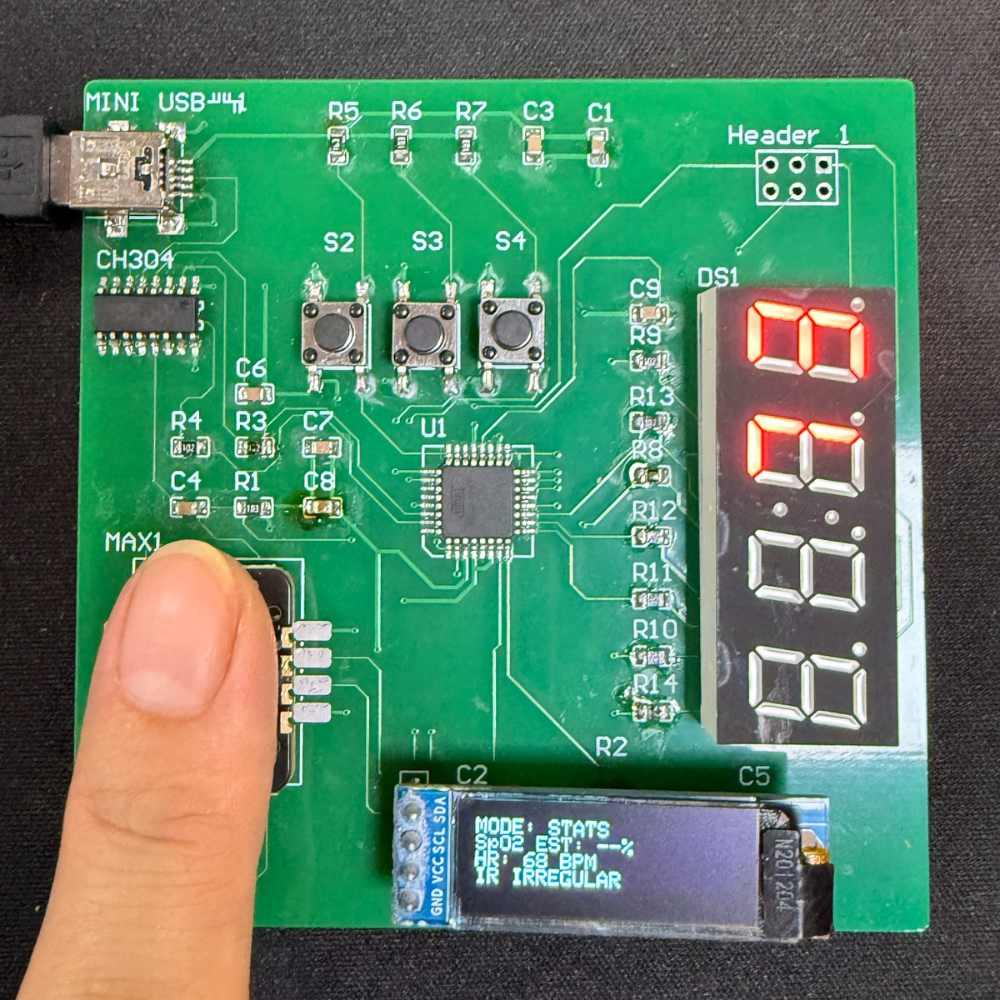
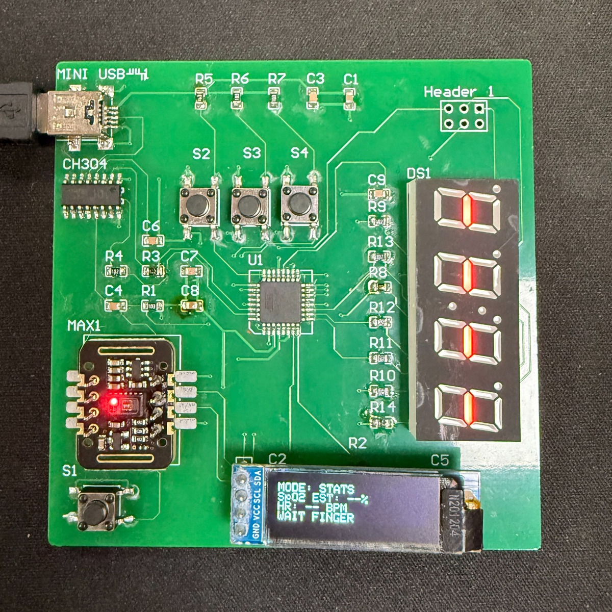

# Custom ATmega328P Optical Sensing Board

## Demonstration Video

<strong>▶ Watch the hardware demonstration (41 seconds)
</strong>

https://github.com/user-attachments/assets/f70d3435-f54f-49b9-8b4e-e0606775f0d9

## 1. Hardware Design

### Schematic Design

The project began with a schematic drawn in Altium Designer around the ATmega328P-AU. I brought together the MCU's power, clock and reset circuits, the USB-to-UART and ISP interfaces, and connections for the MAX30102 sensor, OLED, seven-segment display and buttons. This established the electrical foundation for the custom board, with the circuit details covered in the [Hardware Design Notes](docs/design-notes.md).

 

Click the image to view the complete schematic (PDF).

### PCB Layout and Routing

With the circuit connections defined, the next step was turning them into a physical layout. In Altium Designer, I placed the components and routed both PCB layers, bringing the sensing, display, control and programming interfaces together on one board.

This is the actual layout used for fabrication, not a conceptual illustration. It also reflects the practical compromises of an initial prototype; the placement and routing choices, along with possible improvements, are discussed in the [Hardware Design Notes](docs/design-notes.md).

 

Click the image to view the full PCB layout (PDF).

## 2. PCB Fabrication, Assembly and Bootloader Programming

### Fabrication and Assembly

  
  

Once the layout was complete, it was sent for PCB fabrication. The bare board provided the physical starting point; I then populated and soldered the components to assemble the complete prototype. The two photographs capture that progression from manufactured PCB to assembled hardware, before power-on.

### Bootloader Programming

An assembled board still needed a way to receive firmware. Before normal serial uploads through Mini USB and the CH340C could work, I used a commercial UNO R3 six-pin ISP programmer to initialise the ATmega328P-AU through the temporary ISP contacts. The target was powered via Mini USB, and the programmer's steady green LED indicated a successful Bootloader operation.

With that initial step complete, the USB-to-UART interface could be used for application uploads. The programming sequence, contact orientation and LED indications are documented in the [Bootloader Programming Setup](docs/programming-setup.md).

 

## 3. Firmware Demonstration

The assembled and initialised board comes to life through its firmware. The application reads red and infrared samples from the MAX30102 and turns them into feedback on the two displays. RAW exposes the sensor readings directly, while STATS presents a heart-rate estimate, an uncalibrated oxygen-saturation estimate when available, and signal-quality feedback.

### Application Modes

| RAW Mode | STATS — Measuring | STATS — Idle |
|:---:|:---:|:---:|
|  |  |  |

The firmware work also includes two independently uploadable Arduino sketches. I used the `debug` sketch's serial console to check individual peripherals, then integrated sensor acquisition, pulse processing, display updates and button interaction in the `main` application. Both sketches include the driver headers they need and run separately on the MCU. The [Firmware Overview](docs/firmware-overview.md) explains the software structure, signal-processing methods and upload procedure; third-party notices are retained in [`firmware/THIRD_PARTY_LICENSES.txt`](firmware/THIRD_PARTY_LICENSES.txt).

## 4. Scope and Limitations

This is a working embedded prototype built to demonstrate the complete path from circuit design and PCB layout through fabrication, soldering, board bring-up and firmware integration. The PCB shown above is the one used to build the prototype, though its component placement and routing leave room for refinement.

The optical measurements have not been calibrated or systematically validated against a reference instrument. In particular, `SpO2 EST` is an engineering estimate for demonstrating signal processing, **not a medical measurement**.
