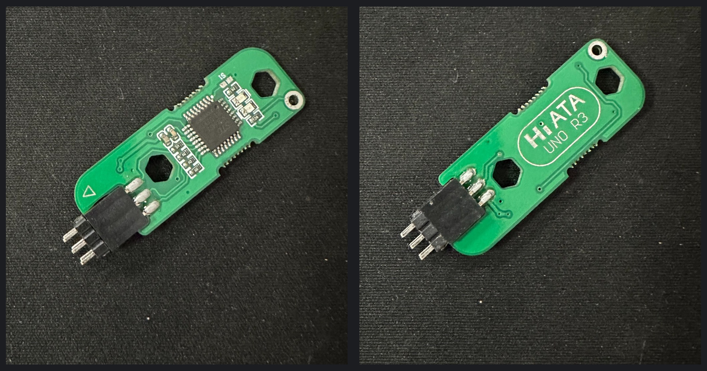

# Bootloader Programming Setup

This note records the **initial Bootloader programming procedure actually used** for the custom ATmega328P-AU PCB. It covers the external programmer, the temporary ISP connection, and the programmer's LED feedback. It is not a general tutorial for all AVR programmers.

For the circuit design of the ISP and USB-to-UART interfaces, see the [Hardware Design Notes](design-notes.md). Firmware source code, peripheral tests, and application behaviour are reserved for the [Firmware README](../firmware/README.md), which will be completed alongside the firmware documentation.

## 1. Overview

The board uses an **ATmega328P-AU** with an external **16 MHz crystal**. Its on-board **CH340C** provides a USB-to-UART connection through Mini USB. Serial uploading through this interface requires a compatible Bootloader on the MCU; a blank MCU cannot be programmed through the CH340C alone using the normal Arduino serial-upload process.

For initialisation, the PCB includes a **2×3 AVR ISP interface**. An external programmer can access the MCU directly through this interface, independently of the serial Bootloader. The PCB was designed without a permanently soldered ISP header: the six programming contacts were used temporarily.

## 2. Programming Hardware

The initial Bootloader was programmed with a commercially available **UNO R3 six-pin Bootloader programmer**. This device performs its programming operation automatically when connected to the powered target, and reports the result through an on-board red/green LED. The exact manufacturer, internal firmware, and fuse-byte values are not documented here.

The equipment used was:

- The assembled custom ATmega328P-AU PCB.
- The UNO R3 six-pin Bootloader programmer.
- A Mini USB cable supplying **5 V power to the target PCB**.
- The PCB's unpopulated 2×3 ISP through-hole footprint.

The ISP connector carries **MISO, MOSI, SCK, RESET, VCC and GND**. Correct orientation and contact with all six holes are essential. The corresponding circuit is shown in the [schematic PDF](../hardware/schematic/schematic.pdf).

## 3. Automatic Bootloader Programming

The following sequence describes the **specific programmer and procedure used for this prototype**:

1. Connect the target PCB to **Mini USB power**.
2. Align the programmer's six pins with the PCB's 2×3 ISP holes, paying attention to the correct orientation.
3. Insert the pins into the holes. The programmer starts its operation automatically.
4. Observe the programmer's LED, which **alternates between red and green** while programming is in progress.
5. Wait for a steady indication:
   - **Steady green:** the programmer reports a successful operation.
   - **Steady red:** the programmer reports failure.
6. If the result is red, the approach used during development was to remove the programmer, check its alignment and contact, then reinsert it to retry. Intermittent contact with the unsoldered holes was a possible cause of failure.

**Connection caution:** This particular workflow involved inserting the programmer while the target board was powered. It is a record of the procedure used, **not a recommendation to hot-plug arbitrary ISP tools**. Misalignment or momentary shorts are possible when inserting bare pins into a live board. The power and connection procedure must be appropriate for the specific programmer being used.

No Arduino IDE *Tools → Burn Bootloader* command was part of this recorded automatic-programmer workflow, and no manual fuse-byte settings are claimed.

## 4. Result and Firmware Development

The programmer's **steady green LED** was the success indication used for Bootloader initialisation. The photograph below documents the programmer connected to the assembled PCB during this stage.

This LED indication is the programmer's reported result; it is not a separate software readback log or a complete test of subsequent serial uploads. With a compatible Bootloader installed, the intended next step is firmware development through the board's **Mini USB → CH340C → ATmega328P UART** path.

Details of peripheral drivers, the hardware-test entry point, the application entry point, and the actual build/upload procedure belong in the [Firmware README](../firmware/README.md).
